# Awesome PCI-DSS & Data Security Management 🛡️💳

  

  
  
  
  
  
  

> 🛡️ **A curated collection of top PCI-DSS (Payment Card Industry Data Security Standard) and Data Security Management platforms** — covering Cloud Security Posture Management (CSPM), Cloud Native Application Protection Platforms (CNAPP), Cardholder Data Environment (CDE) isolation, sensitive data discovery, vulnerability scanning, and open-source continuous compliance frameworks.
>
> 🌟 *Star this repository if you find it valuable for your security, devops, or compliance audits!* 🌟

---

## 📑 Table of Contents

- [🌐 Sector Overview & Market Dynamics](#-sector-overview--market-dynamics)
- [🟦 SaaS & Commercial Hosted Platforms](#-saas--commercial-hosted-platforms)
- [🟩 Open-Source Software](#-open-source-software)
- [📊 Comparison at a Glance](#-comparison-at-a-glance)
- [📈 Star History](#-star-history)
- [💖 Support](#-support)
- [🤝 Contributing](#-contributing)
- [📄 License](#-license)

---

## 🌐 Sector Overview & Market Dynamics

The global data security and compliance management market is valued at approximately **$24.5 billion** (with the broader Cloud Security Posture & CNAPP market projected to surpass **$38 billion by 2030** at an annual growth rate exceeding 19%). The sector is **moderately fragmented yet increasingly consolidating**, characterized by enterprise platform titans (such as Palo Alto Networks, CrowdStrike, and Fortinet) aggressively acquiring niche innovators (e.g., Lacework) alongside fast-growing decacorns like Wiz, while highly specialized open-source tools and boutique compliance orchestrators continue to cater to custom engineering workflows and developer-first security teams.

---

## 🟦 SaaS & Commercial Hosted Platforms

The table below lists leading commercial, cloud-hosted PCI-DSS and Data Security Management platforms sorted in descending order by company size (valuation / annual revenue).

| Company / Product | Size (Valuation / Revenue) 🏢 | Starting Tier Pricing 💰 | Free Tier / Trial Limits ⏳ | PCI DSS & Core Data Security Focus 🛡️ |
|:---|:---|:---|:---|:---|
| **[Palo Alto Networks (Prisma Cloud)](https://www.paloaltonetworks.com/prisma/cloud)** | ~$115B Market Cap ($8.0B FY24 Revenue) | Starting at $9,000/year (~$90/credit pack minimum commit for 100 credits) | 30-day full-featured free trial with up to 250 cloud workloads/instances monitored | 50+ compliance frameworks including full PCI-DSS v4.0 mapping, multi-cloud CSPM/CWPP, and automated audit evidence reporting. |
| **[CrowdStrike Falcon](https://www.crowdstrike.com/)** | ~$85B Market Cap ($3.05B FY24 Revenue) | Falcon Go starting at $59.99/device/year (minimum 5 devices, billed annually at $299.95/yr) | 15-day free trial supporting up to 100 endpoints with Falcon Prevent (NGAV) and Falcon Insight (EDR) | Validated by Coalfire QSA for PCI DSS v4 Requirement 5 (antivirus/anti-malware defenses) with customer Attestation of Compliance (AOC). |
| **[Datadog Cloud Security](https://www.datadoghq.com/)** | ~$40B Market Cap ($2.13B FY24 Revenue) | Pro Cloud Security Management starting at $7.50/host/month (or $15/host/mo for full Workload Protection) | 14-day free trial with unlimited hosts and full metric retention; Free tier supports up to 5 hosts (metrics only, security scanning requires paid/trial plan) | PCI v4.0 compliant tooling, Sensitive Data Scanner (detecting/masking cardholder data in logs/APM), File Integrity Monitoring (FIM), and 1,000+ out-of-the-box compliance rules. |
| **[Fortinet (FortiCNAPP / Lacework)](https://www.fortinet.com/)** | ~$65B Market Cap ($5.3B FY24 Revenue; acquired Lacework in 2024) | FortiCNAPP enterprise starting tier at ~$1,200/license/year (or ~$3,000/year base commit via AWS/Azure Marketplace) | 14-day free trial with up to 50 cloud resource units/nodes analyzed | Daily continuous automated compliance reporting against CIS, PCI DSS, SOC 2, and HIPAA with native CLI automation (`lacework compliance`). |
| **[Wiz](https://www.wiz.io/)** | ~$12B Valuation (Series E, ~$500M ARR) | Enterprise minimum contract starting at ~$15,000–$25,000/year (billed annually based on scanned workloads) | Interactive guided sandbox demo; custom 14-day proof-of-concept (PoC) free trial for verified enterprise accounts | Cloud-native risk graph, automated PCI DSS v4.0.1 compliance checks, and published customer-facing Attestation of Compliance (AOC) / Report on Compliance (ROC). |
| **[Orca Security](https://orca.security/)** | ~$1.8B Valuation ($50M+ ARR) | Essentials tier starting at ~$12,000/year (~$300–$400/asset/year based on cloud inventory volume) | 30-day free trial with automated agentless scanning for up to 50 virtual machines / cloud assets | 100% agentless multicloud posture covering PCI DSS, SOC 2, HIPAA, and CIS with real-time drift alerts and one-click audit dossiers. |

---

## 🟩 Open-Source Software

Self-hosted, community-driven tools for automated PCI-DSS auditing, sensitive data discovery, vulnerability management, security posture, and compliance validation. Sorted in descending order by GitHub stargazers.

| Project & Repo | Stars 🌟 | Stack / Ecosystem 💻 | License ⚖️ | PCI DSS & Data Security Capabilities 🔍 |
|:---|:---|:---|:---|:---|
| **[Trivy](https://github.com/aquasecurity/trivy)** |  | Go | Apache-2.0 | Comprehensive security scanner for container images, file systems, Git repositories, virtual machine images, and Kubernetes. Built-in compliance flags (`trivy k8s --compliance=pci-dss-v4.0`) map vulnerabilities and misconfigurations directly against PCI DSS benchmarks. |
| **[Osquery](https://github.com/osquery/osquery)** |  | C++ | Apache-2.0 / GPL-2.0 | Exposes an operating system as a high-performance relational database. Used across endpoints and servers in Cardholder Data Environments (CDE) to verify file integrity monitoring (FIM), system user privileges, listening ports, and patch compliance required by PCI DSS Requirements 1, 2, 8, 10, and 11. |
| **[Wazuh](https://github.com/wazuh/wazuh)** |  | C, Python, C++ | GPL-2.0 | Open-source SIEM and XDR engine featuring out-of-the-box rule mappings for **PCI DSS v3.2.1 and v4.0**. Delivers File Integrity Monitoring (FIM - Req 11.5), Log Data Analysis (Req 10), Vulnerability Detection (Req 6.2), and System Hardening evaluation (Req 2). |
| **[Semgrep](https://github.com/semgrep/semgrep)** |  | OCaml, Python | LGPL-2.1 / Commercial | Fast static application security testing (SAST) and secrets scanner. Helps enforce PCI DSS Requirement 6.2 (vulnerability elimination) and 6.3.1 (hardcoded credential eradication) with CI/CD gates that prevent leaking sensitive payment data or insecure cryptography. |
| **[Prowler](https://github.com/prowler-cloud/prowler)** |  | Python | Apache-2.0 | Open-source cloud security posture assessment tool for AWS, Azure, Google Cloud, and Kubernetes. Includes predefined compliance packs for **PCI-DSS (3.2.1 & 4.0)**, executing hundreds of automated cloud configuration checks with HTML, CSV, and JSON audit evidence output. |
| **[Syft](https://github.com/anchore/syft)** |  | Go | Apache-2.0 | CLI tool and library for generating Software Bills of Materials (SBOMs) in SPDX and CycloneDX formats from container images and filesystems. Directly fulfills mandatory **PCI DSS 4.0 Requirement 6.3.2** (managing and inventorying third-party software components and open-source dependencies). |
| **[ComplianceAsCode (SSG)](https://github.com/ComplianceAsCode/content)** |  | Python, SCAP, Ansible | LGPL-2.1 | Automated security compliance content and benchmarks. Provides official SCAP profiles and Ansible/Bash remediation playbooks specifically mapped to **PCI-DSS** baselines for Linux systems (RHEL, Ubuntu, Fedora, CentOS, SLE). |
| **[OpenSCAP](https://github.com/OpenSCAP/openscap)** |  | C, Python | LGPL-2.1 | NIST-certified Security Content Automation Protocol (SCAP) scanner. Evaluates host configurations, hardening guidelines, and patch levels to enforce and generate machine-readable auditor reports for PCI-DSS compliance in production Linux infrastructure. |
| **[OpenWatch](https://github.com/Hanalyx/kensa)** |  | Go, PostgreSQL, React | GPL-3.0 / Commercial | Continuous fleet compliance platform for Linux hosts powered by the 779-rule Kensa corpus. Supports point-in-time drift detection for PCI DSS, NIST 800-53, and CIS, with machine-verifiable evidence exports (CSV, JSON, PDF, OSCAL) and exception audit workflows. |
| **[pci-dss-mcp](https://github.com/shyshlakov/pci-dss-mcp)** |  | Go | MIT / Open Source | Static code scanner tailored for Go codebases checking PCI DSS v4.0.1 requirements (covering PAN detection, cardholder data transit vs database leakage, and sensitive logger detection) with transparent suppression tracking. |

---

## 📊 Comparison at a Glance

| Tool / Platform | Category | Primary Stack | PCI DSS Coverage Focus | Audit Evidence Formats | Deployment Model | Best Suited For |
|:---|:---|:---|:---|:---|:---|:---|
| **Prisma Cloud** | Commercial SaaS | Cloud Multi-Tenant | Broad (50+ standards, full v4.0) | PDF, CSV, API, Executive Dossiers | SaaS / Cloud Agentless + Daemon | Enterprise multi-cloud CSPM & automated QSA evidence |
| **CrowdStrike Falcon** | Commercial SaaS | Agent / Cloud | Req 5 (Anti-malware) & Host Controls | Attestation of Compliance (AOC), Telemetry | Managed Cloud + Kernel/eBPF Agent | Endpoint malware & detection across CDE environments |
| **Datadog Security** | Commercial SaaS | Agent / Cloud | Req 10 (Logs), FIM, Sensitive Data Scanner | 15-month historical logs, PDF, Compliance Dashboards | SaaS + Observability Agent | Teams combining observability with PCI posture |
| **FortiCNAPP (Lacework)**| Commercial SaaS | Cloud Multi-Tenant | CIS, PCI DSS, SOC 2, HIPAA | CLI, PDF, CSV, JSON | SaaS / Agentless & Agent | DevOps & infrastructure teams utilizing CLI-first auditing |
| **Wiz** | Commercial SaaS | Cloud Multi-Tenant | Cloud Infrastructure & CDE Risk Graph | AOC, ROC, Cloud Audit Reports | SaaS / 100% Agentless API | Fast cloud risk triage and visual architecture scanning |
| **Orca Security** | Commercial SaaS | Cloud Multi-Tenant | 185+ frameworks including PCI DSS v4 | One-Click Auditor Dossier, CSV | SaaS / Agentless SideScanning™ | Zero-overhead multi-cloud asset discovery and audit prep |
| **Trivy** | Open Source | Go | Req 6.2, Container & K8s PCI posture | JSON, SARIF, ASCS, Table | Self-Hosted CLI / CI Pipeline | Fast container and Kubernetes PCI compliance checks |
| **Osquery** | Open Source | C++ | Req 1, 2, 8, 10, 11 (Host telemetry & FIM) | SQLite / JSON query results | Self-Hosted Endpoint Daemon | Host introspection, custom SQL compliance telemetry |
| **Wazuh** | Open Source | C / Python | Req 10 (Logging), 11.5 (FIM), System Hardening | Elastic/OpenSearch Dashboards, CSV | Self-Hosted On-Prem / Cloud | Turnkey open-source PCI SIEM & XDR |
| **Semgrep** | Open Source | OCaml / Python | Req 6.2, 6.3.1 (Secrets & SAST) | SARIF, JSON, CI/CD Gate logs | Self-Hosted CLI / On-Prem / SaaS | Secure code review and payment data leak prevention |
| **Prowler** | Open Source | Python | AWS / Azure / GCP / K8s PCI Benchmarks | HTML, CSV, JSON, JUnit | Self-Hosted CLI / Lambda / Container | Infrastructure-as-code and cloud tenant PCI audits |
| **Syft** | Open Source | Go | Req 6.3.2 (Mandatory Software Inventory & SBOM)| SPDX, CycloneDX, Syft-JSON | Self-Hosted CLI / Pipeline tool | Automated SBOM generation for cardholder processing software |
| **ComplianceAsCode** | Open Source | Python / SCAP | OS hardening baselines for PCI-DSS | SCAP XML, HTML checklists, Ansible | Self-Hosted System Hardening | Automated Linux OS hardening and baseline enforcement |
| **OpenSCAP** | Open Source | C / Python | SCAP evaluation & CIS/PCI benchmark checks | XCCDF, OVAL HTML/XML reports | Self-Hosted CLI / Daemon | Government & enterprise Linux compliance verification |
| **OpenWatch** | Open Source / Pro | Go / Postgres | Fleet-wide Linux drift & continuous PCI DSS | CSV, JSON, PDF, OSCAL | Self-Hosted Server | Historical point-in-time fleet drift assessment |
| **pci-dss-mcp** | Open Source | Go | Code-level PAN tracking & taint analysis | Terminal, JSON findings | Self-Hosted Go CLI | Go backend microservices handling cardholder data |

---

## 📈 Star History

---

## 💖 Support

If you find this repository helpful in navigating PCI-DSS compliance, preparing for QSA audits, or securing sensitive cardholder data, thank you for supporting this project!

Here are ways you can contribute:
- ⭐ **Star this repository** to help others discover it.
- 🍴 **Fork and contribute** by submitting new tools, updates, or fixes.
- 📢 **Share** this list with fellow security engineers, compliance managers, and DevOps teams.
- ☕ **Sponsor / Buy me a coffee:** Support ongoing open-source research and maintenance via the [GitHub Sponsor Dashboard](https://github.com/sponsors/ishandutta2007).

---

## 🤝 Contributing

Contributions are welcome! If you know of an open-source or notable PCI-DSS / Data Security Management tool that should be included here, please submit a pull request.

Please review the guidelines:
1. Ensure the tool is actively maintained with releases within the last 12 months.
2. Provide a clear description of which specific PCI DSS requirements (e.g., Req 5 malware, Req 6 secure coding/SBOM, Req 10 logging, Req 11 FIM/testing) or data security vectors the tool addresses.
3. Keep entries objective and factual without promotional jargon.

> ℹ️ *Note on PCI DSS:* No single automated tool guarantees 100% compliance. A Qualified Security Assessor (QSA) must evaluate your overall control environment, organizational policies, key management, and physical security alongside technical automated scans.

---

## 📄 License

This repository and curated list are released under the [Creative Commons Zero v1.0 Universal (CC0 1.0)](LICENSE) Public Domain Dedication. Listed third-party tools, trademarks, and logos are property of their respective owners.
